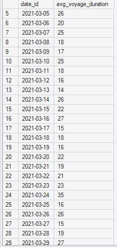
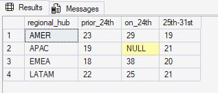

# Suez Canal Disruption: Analyzing the Impact on Global Maritime Logistics

## Project Description

In March 2021, the *Ever Given* container ship blocked the Suez Canal for six days, disrupting a major global shipping route. This project investigates the impact of the disruption on maritime cargo movements and terminal efficiency during Q1 2021, examining changes in cargo volumes, regional differences, and the time required for operations to recover.

## Business Problem

The Suez Canal blockage disrupted global maritime transportation, potentially affecting cargo movements, port operations, and shipping schedules. Maritime logistics stakeholders need to understand the extent of the disruption, which regional hubs experienced the greatest impact, and how quickly operations recovered.

Using the available maritime dataset, this analysis aims to identify the disruption's footprint and assess its implications for cargo movement and operational efficiency.

## Project Objectives

1. **Identify the disruption:** Determine when the impact of the Suez Canal blockage becomes visible in the Q1 2021 data.
2. **Measure cargo movement changes:** Compare cargo volumes before, during, and after the disruption to identify unusual changes and possible recovery patterns.
3. **Compare regional impacts:** Evaluate differences in cargo movements and terminal efficiency across EMEA, APAC, and AMER.
4. **Assess operational recovery:** Estimate how long it took for cargo movements and terminal performance to return to their pre-disruption levels.

## Analytical Questions

1. When does the disruption become visible in the data, and does the timing align with the known incident?
2. Did cargo volumes decline or spike before, during, or after the incident?
3. Which regional hub (EMEA, APAC, or AMER) experienced the greatest change in cargo movements?
4. How did terminal efficiency change during the disruption?
5. How long did it take for cargo movements and terminal efficiency to return to normal?


## Tools and Methodology

### Tools

- **SQL Server:** Exploratory data analysis (EDA), trend analysis, regional comparisons, and calculation of key performance indicators.
- **Power BI:** Data visualization and interactive dashboards for investigating the disruption's impact on cargo movements and terminal efficiency.

### Methodology

1. **Exploratory Data Analysis:** Use SQL to examine cargo movements, terminal performance, date patterns, and regional distributions to understand the dataset and identify potential anomalies.

2. **Disruption Analysis:** Investigate changes in cargo movements and terminal efficiency before, during, and after the Suez Canal blockage in March 2021.

3. **Regional Comparison:** Compare the disruption's observed impact across EMEA, APAC, and AMER to identify differences in cargo movements and terminal performance.

4. **Recovery Analysis:** Establish pre-disruption performance baselines and measure how long cargo movements and terminal efficiency took to return to normal levels.

5. **Data Visualization:** Use Power BI to present trends, regional comparisons, performance indicators, and recovery patterns in an interactive dashboard.


## Dataset Documentation

For details about the dataset, table descriptions, key columns, and relationships, see the [Data Dictionary](docs/data_dictionary.md).


## SQL Exploratory Data Analysis (EDA)

## 1. Measuring the Immediate Impact

Following the Suez Canal disruption, stakeholders need to understand how the incident affected maritime operations, whether performance eventually recovered, and how long that recovery took.

The six-day blockage prevented vessels from passing through the canal, creating a backlog of ships waiting to transit. But how did this disruption translate into longer voyage durations?

To investigate this, I used SQL to calculate the average voyage days (move duration) for each day of March 2021, to easily spot any unusual delay for in any of the month. 

```sql
SELECT
  r.date_id,
  ROUND(AVG(move_duration/24),2) AS avg_voyage_days
FROM fact_cargo_movements AS l
INNER JOIN dim_time AS r
ON l.date_id = r.date_id
WHERE fiscal_year =  2021 AND month = 3
GROUP BY r.date_id
```
## Result



The Suez Canal disruption began on 23 March 2021. The query results show that average movement duration increased from 23 days on 23 March to 35 days on 24 March. This sharp increase suggests that vessels recorded on the day after the disruption began experienced longer movement durations.

## How Did the Disruption Affect Regional Hubs?

```sql
SELECT 
 regional_hub,
 ROUND(AVG(CASE WHEN r.date_id BETWEEN '2021-03-01'  AND '2021-03-23' THEN move_duration/24 END),0) AS prior_24th,
 ROUND(AVG(CASE WHEN r.date_id = '2021-03-24' THEN move_duration/24 END),0) AS on_24th,
 ROUND(AVG(CASE WHEN r.date_id >= '2021-03-25' AND r.date_id < '2021-04-01' THEN move_duration/24 END),0) AS '25th-31st'
FROM fact_cargo_movements AS l
INNER JOIN dim_time AS r
ON l.date_id = r.date_id
INNER JOIN dim_terminal AS z
ON l.terminal_id  = z.terminal_id
WHERE fiscal_year = 2021 AND r.month = 3
GROUP BY regional_hub
```

The query above calculates the average time it took vessels to reach their destinations by dividing March into three periods:

1. Pre-disruption period: 1 March to 23 March, the day the incident began.
2. Immediate post-disruption period: 24 March, when the spike in average movement duration was observed.
3. Later post-disruption period: 25 March to 31 March.


## Result




The result shows that 24th, the average voyage days across regional hubs showed a marked increase. EMEA’s average doubled, reflecting a 19-day increase compared to the pre–24th average. AMER and LATAM recorded increases of 7 and 4 days, respectively, while APAC had no recorded voyages on that day. However, from the 25th through the end of March, the average dropped back to near pre–24th levels.

## Data Visualization


